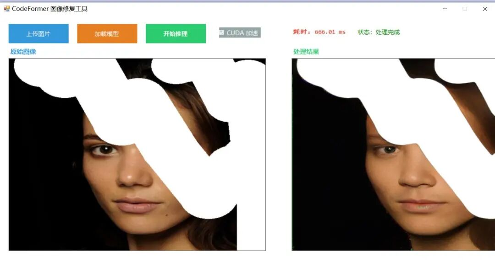

# Deploy a codeformer ONNX model for facial image restoration based on C# WinForm

# Deploying the ONNX model of Codeformer for facial image restoration based on C# WinForm

## CodeFormer image restoration tool

A WinForms application for face image restoration based on ONNXRuntime and OpenCvSharp, which implements the C++ code into the .NET Framework platform.

### Effect Display


Insert image description here.

### 📖 Algorithm Principles

#### CodeFormer Model

CodeFormer is a powerful face restoration algorithm based on the Transformer architecture, capable of:

-

• **Face Restoration**: Restore blurry or low-quality face images

-

• **Detail Enhancement**: Reconstruct lost facial details and textures

-

• **Noise Reduction Process**: Remove noise and compressed artifacts from the image

#### Processing Procedures

```
Input image → Preprocessing → ONNX inference → Post-processing → Output results
```

### 💻 Environment Requirements

#### Development Environment

-

• **IDE**: Visual Studio 2019 or higher version

-

• **.NET Framework** : 4.7.2

-

• **C# Language Version**: 6.0

-

• **Platform Target**: x64

Runtime Dependencies

-

• **OpenCvSharp** : 4.13.0

-

• OpenCvSharp.dll

-

• OpenCvSharp.Extensions.dll

-

• **ONNX Runtime** : 1.20.1

-

• Microsoft.ML.OnnxRuntime.dll

-

• CUDA-related DLL (if using GPU acceleration)

#### GPU acceleration (optional)

If CUDA acceleration is used, the following installations are required:

-

• **NVIDIA CUDA Toolkit** : 12.x

-

• **cuDNN** : 9.x

-

• Supported GPU: NVIDIA graphics card with CUDA support

#### System Requirements

-

• **Operating System**: Windows 10/11 (64-bit)

-

• **Memory**: At least 4GB RAM

-

• **Disk Space**: At least 2GB (including model files)

### 📦 Installation Steps

#### 1. Clone or download the project

```
# If obtained from Git repository
git clone <repository-url>
cd FIRC
```

2. Preparing model files

Ensure that the model files are placed in the correct location:

```
FIRC/bin/x64/Release/weights/codeformer.onnx
```

The model file size is approximately 360MB. If missing, it needs to be downloaded from official channels.

#### 3. Check Dependencies on DLL

Ensure the following DLL files exist in the `bin/x64/Release/` directory:

**OpenCvSharp Related:**

-

• OpenCvSharp.dll

-

• OpenCvSharp.Extensions.dll

-

• dll/x64/OpenCvSharpExtern.dll

-

• dll/x64/opencv_videoio_ffmpeg4130_64.dll

**ONNX Runtime-related:**

-

• Microsoft.ML.OnnxRuntime.dll

-

• onnxruntime.dll

-

• onnxruntime_providers_cuda.dll (CUDA support)

-

• onnxruntime_providers_shared.dll

-

• onnxruntime_providers_tensorrt.dll

**CUDA-related (if using GPU):**

-

• cublas64_12.dll

-

• cublasLt64_12.dll

-

• cudart64_12.dll

-

• cudnn64_9.dll

-

• and other cudnn_*.dll files

4. Open the project

Open the solution file in Visual Studio 2019:

```
FIRC.sln
```

🚀 Running steps

### Method 1: Visual Studio Execution

1.

1. Open the project in Visual Studio

1.

2. Select configuration: **Release** | **x64**

1.

3. Run by pressing F5 or clicking the "Start" button.

### Method 2: Run the executable file directly.

1.

1. Navigate to the output directory: ```
cd bin/x64/Release

```

```

1.

2. Double-click to run: ```
FIRC.exe
```

```

```

#### Usage Process

1.

1. **Upload an image**

-

• Click the "Upload Image" button

-

• Select the image file to be repaired (supports BMP, JPG, JPEG, TIF, PNG)

1.

2. **Loading the model**

-

• Select whether to enable "CUDA acceleration" (requires GPU environment)

-

• Click the "Load Model" button

-

• Wait for the model to load (status bar displays "Model has been loaded [CPU/CUDA]")

1.

3. **Starting the Reasoning**

-

• Click the "Start Reasoning" button

-

• Wait for processing to be completed

-

• View results and time statistics

1.

4. **View Results**

-

• Left side displays the original image

-

• The right side displays the results after repair.

-

• Displays the inference time (in milliseconds) at the bottom

⚠️ Important Notes

#### CUDA GPU Acceleration

1.

1. **First Time Using CUDA**:

-

• Ensure that the CUDA Toolkit 12.x and cuDNN 9.x are installed.

-

• Add CUDA bin directory to system PATH environment variable

-

• If CUDA initialization fails, the program will automatically fall back to CPU mode.

1.

2. **Performance Comparison**:

-

• CPU mode: inference time is about 5-15 seconds (depending on the CPU performance).

-

• CUDA mode: inference time is approximately 0.5-2 seconds (depending on GPU performance)

#### Image requirements

-

• **Input Size**: Any size (the program will automatically scale to 512×512)

-

• **Output Size**: The same as the input size

-

• Recommended format: PNG (lossless) or high-quality JPEG

-

• **Maximum Resolution**: It is recommended not to exceed 4000×4000 pixels.

#### Memory usage

-

• Model loading occupies approximately 400-500MB of memory.

-

• The inference process temporary memory is about 200-300MB

-

• More memory may be required when dealing with large images.

#### Common Issues

**Q: "Model file does not exist"**
A: Check if the file `bin/x64/Release/weights/codeformer.onnx` exists.

**Q: CUDA acceleration is not effective**
A:

-

• Confirm GPU support for CUDA

-

• Check if the CUDA and cuDNN versions match.

-

• Check if the CUDA DLL is complete.

**Q: Slow reasoning speed**

-

• Enable CUDA acceleration

-

• Reduce the input image resolution

-

• Close other programs that are using resources

### 📁 Project Structure

```
FIRC/
├── FIRC.sln                      # Visual Studio Solution file
├── FIRC.csproj               # Project configuration file
├── App.config  # Application configuration file
├── Program.cs  # Program entry point
│
├── CodeFormer.cs  # CodeFormer model inference class (core)
├── Form1.cs  # Main form business logic
├── Form1.Designer.cs # Main form UI design
├── Form1.resx  # Form1 resource file for the form
│
├── Properties/                 # Project properties
├── AssemblyInfo.cs # Program Metadata
├── Resources.resx # resource file
│ ├── Resources.Designer.cs  # Resource Designer
│ ├── Settings.settings  # Set file
└── Settings.Designer.cs # Set Designer
│
├── images/ # Test image directory
│   ├── 41.png
│   ├── naruto.jpg
└── ... (other test images)
│
├── bin/x64/Release/ # Compilation output directory
│   ├── FIRC.exe                  # Executable file
├── FIRC.pdb # Debugging symbols
│   │
├── weights/  # Model file directory
│ └── codeformer.onnx # CodeFormer ONNX model (360MB)
│   │
│   ├── dll/x64/                  # OpenCvSharp Native DLL
│   │   ├── OpenCvSharpExtern.dll
│   │   └── opencv_videoio_ffmpeg4130_64.dll
│   │
├── OpenCvSharp.dll # OpenCvSharp managed library
│   ├── OpenCvSharp.Extensions.dll
│   ├── Microsoft.ML.OnnxRuntime.dll
│   ├── onnxruntime.dll           # ONNX Runtime Core
│   │
├── CUDA-related DLL/# GPU acceleration support
│   │   ├── cublas64_12.dll
│   │   ├── cudart64_12.dll
│   │   ├── cudnn64_9.dll
└── ... (Other CUDA/cuDNN DLLs)
│   │
└── Other dependencies DLL/
│       ├── System.Buffers.dll
│       ├── System.Memory.dll
└── ... (.NET Runtime Library)
│
├── main.cpp  # Original C++ implementation reference code
├── README.md  # Project Description Document (This file)
└── Instructions.txt  # Simple usage instructions
```

### Notes

The correct procedure for codeformer face restoration is as follows: First, detect the face and then crop it for restoration. This approach does not involve restoring the entire image; instead, it focuses on repairing the damaged areas of the face. Moreover, the model is specifically designed for face restoration, enhancing clarity rather than blurring. In addition to the face inpainting model, there are also image colorization models available. For instance, attempting to restore the image using the following method is incorrect:
Example of a failed restoration: The model cannot repair the damaged area because it does not utilize an inpainting model.



Insert image description here.

Failure repair example 2: Direct repair of the entire image is not possible; facial recognition must be first detected.


Insert image description here.

### 📝 Version Information

-

• **Current Version**: 1.0.0

-

• **Framework Version**: .NET Framework 4.7.2

-

• **C# Syntax Version**: 6.0

### 📄 License

This project is for learning and research purposes only. The CodeFormer model adheres to its original license.

🙏 🙏

-

• **CodeFormer Original Author**: Providing powerful image restoration models

-

• OpenCvSharp team: excellent .NET OpenCV encapsulation

-

• ONNX Runtime Team: Efficient cross-platform inference engine


## Payment

Here is a pay link on Stripe ( https://buy.stripe.com/3cs8yP7sY87d0vu9AB ). Please contact me lonlonago@foxmail.com after funding $89, and I will send you a complete data files , thank you!


